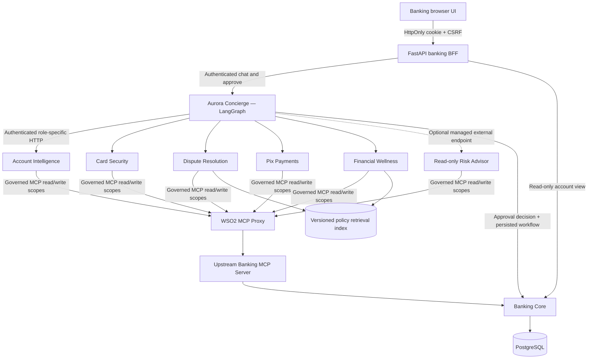

# Banco Aurora — A Governed Banking Multi-Agent Experience

> **Synthetic banking demonstration; not a live bank or production security reference.**
> **Source baseline:** Executive v3 is based on the previously delivered VP-hardening source snapshot (corresponding to the work subsequently pushed to `main` as `b2f746c`). GitHub network fetch was unavailable in this execution environment; reconcile independent remote changes before replacing your checkout. This package is an upgrade artifact, not an assertion that remote GitHub has already been updated.
>
> **Deployment:** WSO2 Agent Manager / on-prem deployment is **manual**. This repository provides six independent Custom API Agent Git build paths and exact environment templates; no automatic Agent Manager provisioning is performed or claimed.

**Executive v3 deliverables:** eight scenario cards, optional externally hosted Risk Advisor, case management, risk refusals, hypothetical cash-flow, granular MCP tool scopes, managed LLM-provider configuration, config preflight and a six-scenario write-capable acceptance runner. **Native Agent Manager** guardrails, AgentID scope policies, trace monitors, Agent Kinds and promotion/rollback remain manual console tasks; see [Platform Scenarios](docs/PLATFORM-SCENARIOS.md).

**Start here:** [Executive Playbook](docs/EXECUTIVE-PLAYBOOK.md) · [Manual AMP deployment](docs/DEPLOY-MANUAL-AMP.md) · [Platform capabilities](docs/PLATFORM-SCENARIOS.md) · [Banking data contract](docs/BANKING-DATA-CONTRACT.md).

```bash
# Existing .env users keep their local credentials; update from .env.example as needed.
bash scripts/run-local.sh
# Execute S01–S06 and reset synthetic data before and after:
bash scripts/verify-executive.sh --full  # runs from Docker, no host httpx installation
# or run the individual scripts if you already have their Python dependencies:
python scripts/run-executive-scenarios.py --report executive-scenario-report.json
python scripts/evaluate-scenarios.py executive-scenario-report.json
```
**These last scripts alter/reset demo data; never run them against a real banking backend.**

## 1 — The story: one customer, one conversation, six agents

**Banco Aurora** is a fictional Brazilian digital bank. **Camila Rocha** notices an unfamiliar **R$ 1,280 Orion Digital credit-card transaction**. She wants to block her card, register a dispute, make an urgent **R$ 1,250 condominium Pix payment**, then check whether she can afford her remaining commitments.

She can do this from a bilingual English/Spanish banking portal without juggling multiple workflows. **Aurora Concierge** is the only customer-facing agent. It interprets the request, chooses specialists, gathers independent evidence, requests user approvals, invokes specialists to perform authorized actions, verifies persisted results and responds in the requested language.

The customer must be able to verify *everything the agent says* in the bank's simulated Core: card status, dispute case, Pix receipt, checking balance, cash-flow projection, event history and approval state.

### Financial baseline

| Measure | Before | After approved Pix |
|---|---:|---:|
| Checking balance | R$ 8,450.00 | R$ 7,200.00 |
| Credit-card charge being disputed | R$ 1,280.00 | No refund, no checking debit |
| Pix payment | Not sent | R$ 1,250.00 (simulation) |
| Upcoming known obligations | R$ 2,100.00 | R$ 2,100.00 |
| Projected remaining checking funds | R$ 6,350.00 | R$ 5,100.00 |

Obligation due dates are generated relative to the date of a **reset** so the demonstration stays relevant beyond October 2026. Forecasts include obligations due today or later; they exclude unknown future commitments, income and other uncertainty. The second fictional customer **Alex Rivera** (C002) is solely for isolation and negative-security tests.

### What this showcases to executives

1. **Experience:** a full cross-domain customer journey, including clarifications and Spanish/English responses.
2. **Execution:** persisted simulated banking transactions, with user approvals and proof of state change.
3. **Governance:** independently permissioned agents and MCP tools, with OAuth policies enforced by WSO2's gateway *when manually configured*.
4. **Observability:** a correlation ID spanning participating services, optional OTel export, and distinct business audit records.
5. **Resilience:** safe repeat approvals and stable Pix idempotency after lost HTTP responses.

## 2 — Architecture and communication



**Local Compose** connects specialist MCP clients directly to the upstream FastMCP endpoint (there is no WSO2 gateway in local mode). **Managed mode** requires WSO2 MCP Proxy, AgentID identity roles, per-tool OAuth scope mappings and appropriate Invoke URLs. The upstream service is a standard Kubernetes/VM app and is **not** Agent Manager's administrative MCP server.

### Responsibilities of each agent

| Agent | Business responsibility | Actual MCP tools or communication |
|---|---|---|
| **Aurora Concierge** (customer-facing) | Language, intent, specialist selection, orchestration, persisted approval workflow, authorized execution and post-commit verification | Authenticated `/chat`, `/execute` on specialists and `/workflows`/`/approvals` with Core; **no Banking MCP permission** |
| **Account Intelligence** | Explain checking balance, transactions and paid Pix receipts | `get_account_balance`, `list_account_transactions`, `get_dispute_status`, `list_beneficiaries` |
| **Card Security** | Identify a single card, show status, prepare approval and block only with authorization | `get_card_status`, `request_card_block`, `execute_approved_card_block` |
| **Dispute Resolution** | Explain cited fictional policies, create disputed-card case; explicit human escalation | `list_card_transactions`, `get_dispute_status`, `get_human_cases`, `request_dispute`, `execute_approved_dispute`, `request_human_escalation`, policy retrieval |
| **Pix Payments** | Check amount, balance, recipient verification and explicit consent; persist single-debit simulated Pix | `get_account_balance`, `list_beneficiaries`, `request_pix`, `execute_approved_pix` |
| **Financial Wellness** | Verified financial projection, without generating a payment approval for what-if prompts | `get_account_balance`, `get_upcoming_obligations`, policy retrieval |
| **Risk Advisor (optional external)** | Read-only advice about known verified/unverified recipient; cannot authorize payment | `list_beneficiaries`; registered as External Agent separately |

The independent agent MCP allowlists in `agents/common.py` are defense in depth. WSO2 OAuth gateway scopes and Core bank authorization must be enforced separately. The optional external risk agent does not replace the deterministic Pix/Banking Core recipient-verification gate.

### How orchestration works

The Concierge is a **LangGraph StateGraph** with explicit **understand → plan → invoke → compose** nodes and a conditional invoke edge. The selection step may use an OpenAI-compatible chat model; without model credentials it uses deterministic routing for a reproducible local demo. Independent specialist calls are concurrent. Dependent banking writes are deliberately **not** concurrent with their read-back: writes pause for approval, use the correct specialist, then re-query the Core-backed Account/Wellness/Card/Dispute agents **after commit**.

A `WorkflowSession` record in Core keeps `pending` approval IDs, completed outcomes, language, steps and clarification context, scoped by the signed demo browser session. If the customer first asks to pay R$1,250 but omits the beneficiary, they can answer with a beneficiary clarification; the Concierge reconstructs the request and *still* performs every specialist validation. It does **not** authorize a write from the LLM's output.

**Result recovery:** an approval decision can be replayed with the same approval ID; Core either executes the action once or returns its already committed effect. A repeated Pix has the same `PIX-<approval-id>` idempotency key, one ledger debit, and one persisted payment record. A response lost between specialist execution and browser delivery must be reconciled by retrying the **same** approval. A failed read-back never turns a completed transaction into a false failure or invents an updated balance.

**Limits:** This is a guarded demo orchestrator, not an autonomous general-purpose banking workflow engine; it does not implement full distributed workflow checkpointing at every network hop, bank-grade OIDC customer delegation, production transaction reconciliation, or a compensation/saga engine.

## 3 — Banking MCP interface: 15 governed tools

Eight purpose-specific read tools: `get_account_balance`, `list_account_transactions`, `get_card_status`, `list_card_transactions`, `get_dispute_status`, `list_beneficiaries`, `get_upcoming_obligations`, `get_human_cases`.

Seven change-related tools: `request_human_escalation`, `request_card_block`, `execute_approved_card_block`, `request_dispute`, `execute_approved_dispute`, `request_pix`, `execute_approved_pix`. Case escalation opens a nonfinancial human-service task only upon an explicit customer request. Banking-money/card/dispute writes continue to require their immutable human approval payloads.

The old broadly exposed `get_banking_snapshot` MCP tool was removed. Banking Core still provides a private state endpoint to the authenticated portal. **Every one of the 15 MCP tools needs an explicit OAuth scope** in Agent Manager because uncovered tools may default-permit authenticated callers. Full scope-to-tool/identity mapping and a negative Account→Pix gateway test are in [Governance Matrix](docs/GOVERNANCE-MATRIX.md).

## 4 — The policy retrieval implementation

This release includes **60 versioned, fictional policy records** (30 each language), including disputes, evidence, duplicate claims, account/cash-flow constraints, Pix beneficiary verification, customer privacy, human escalation and agent governance. `scripts/ingest-policies.py` produces a **persistent SQLite FTS5 lexical index**, preserving document ID/version/effective date. Agents filter by role topic/language, retrieve up to three ranked policies, and generate conservative customer answers using independently verified financial facts. Responses expose citation metadata and the actual retrieval method.

```bash
python scripts/ingest-policies.py
# Optional: build a persistent semantic vector index, requires provider support:
OPENAI_API_KEY=... OPENAI_EMBEDDING_MODEL=text-embedding-3-small \
  python scripts/ingest-policies.py --embeddings
```

Set `POLICY_INDEX_PATH` to a writable **persistent volume path** to reuse the index between agent restarts. If you enable the optional embedding model and vectors exist for the matching model, runtime queries use cosine similarity over those stored vectors. Otherwise they report `persistent_fts5_bm25`, never falsely calling it semantic vector RAG. No unverified real banking regulations or refund promises are in the synthetic policies.

## 5 — Start locally (Docker Compose)

**Prerequisites:** Docker Compose v2, Python 3.12 for standalone scripts, and optional OpenAI-compatible credentials. The portal runs inside Compose; no separate frontend build or npm server is necessary.

```bash
cp .env.example .env
# Change DEMO_ACCESS_CODE, DEMO_RESET_CODE, DEMO_SESSION_SIGNING_KEY,
# BANK_*_KEY, CONCIERGE_*_KEY and SPECIALIST_*_KEY before sharing the demo.
# Set OPENAI_API_KEY only if a supported model is desired.
docker compose up -d --build
bash scripts/smoke-test.sh
open http://localhost:8300
```

**Local-only example credentials:** the Compose fallback sign-in code is `aurora-local-demo-only`; the presenter reset code is `local-presenter-reset`. These are **public demo defaults** and must be changed for any shared environment. The user signs in through a same-origin portal form and receives an `HttpOnly`, signed, one-hour browser cookie; JavaScript does not contain any bearer token or internal shared key. Mutating BFF requests also require a CSRF token. `DEMO_SECURE_COOKIE=true` requires the UI to be served via HTTPS. Behind a TLS reverse proxy, set `DEMO_PUBLIC_ORIGIN=https://your-bank-ui.example` if the internal HTTP base URL differs from the browser origin.

Local health endpoints:

| URL | Component |
|---|---|
| `http://localhost:8300` | Bank portal/UI and BFF |
| `http://localhost:8100/health` | Banking Core |
| `http://localhost:8101/mcp` | Upstream MCP protocol (not a browser page) |
| `http://localhost:8200/health` | Concierge |
| `http://localhost:8201` through `:8205` `/health` | Specialists |

Local Compose port bindings are restricted to `127.0.0.1`. **Do not expose the raw Core, upstream MCP or specialist execute endpoints publicly.** This remains a synthetic demo, not real OIDC banking authentication.

Reset from the UI using the presenter code or run `bash scripts/seed.sh` (see notes: the reset helper also requires the specific Core reset key). Reset also recreates future-dated commitments and C002 testing data. When upgrading an existing previously seeded database, perform a **presenter reset** after saving any synthetic results you want to keep; the first-run bootstrap intentionally preserves existing state.

### Automated verification

```bash
pytest -q
python deployment/agent-manager/scripts/prepare-apps.py
bash scripts/verify-executive.sh          # read-only smoke + isolated tests
# WARNING: performs synthetic writes and resets the demo before and after:
bash scripts/verify-executive.sh --full  # S01–S06 BFF flows and local scorecard
python scripts/integration-test.py      # original authenticated BFF contract suite
```

Unit tests cover ledger/idempotency/approval replay, FK and startup, intent negation/ambiguity, policy retrieval, portal auth and deployment folder contracts. CI source/unit jobs run on each pull request; an optional GitHub Actions `workflow_dispatch` job runs the Compose write-capable integration suite. The test requires the local-only presenter keys or `DEMO_ACCESS_CODE`/`DEMO_RESET_CODE` values set in its environment.

`tests/e2e/` contains an **opt-in** browser UI exercise. Install Playwright and Chromium (`python -m playwright install chromium`), run the portal first, then execute `AURORA_RUN_BROWSER_TESTS=1 pytest -q tests/e2e/`. Do **not** run the write-capable tests against anything except fictional local data.

## 6 — Manually deploy on WSO2 Agent Manager (on-premises)

**No automatic deployment is provided or requested.** The platform/network are yours to configure. Follow [WSO2's official platform-hosted agent guide](https://wso2.com/agent-platform/docs/v1.0.0/guides/configure-agent-mcp-proxies/) and verify the precise on-premises environment, ingress, certificates, image registry, and network reachability.

1. Run `python deployment/agent-manager/scripts/prepare-apps.py`, commit the **generated six application folders** to GitHub, and keep credentials in Agent Manager's environment/secrets configuration (not Git).
2. Manually deploy Core and upstream Banking MCP as private supporting services. Set `BANK_CORE_READ_KEY` and `BANK_CORE_WRITE_KEY` on MCP; Core also needs `BANK_APPROVAL_KEY`, `BANK_RESET_KEY`, `DATABASE_URL`. See `deployment/agent-manager/k8s/supporting-services.yaml` as a **reference manifest**, not auto-installation.
3. In Agent Manager register an MCP Proxy pointing at your reachable upstream `https://.../mcp`, enable **OAuth**, discover 15 tools, assign every tool a scope and roles per [docs/GOVERNANCE-MATRIX.md](docs/GOVERNANCE-MATRIX.md). Uncovered tools are potentially default-permit: check every tool.
4. Manually create **five platform-hosted Custom API Agent** deployments using the Git subdirectories:
   - `deployment/agent-manager/apps/aurora-account`
   - `deployment/agent-manager/apps/aurora-card`
   - `deployment/agent-manager/apps/aurora-dispute`
   - `deployment/agent-manager/apps/aurora-pix`
   - `deployment/agent-manager/apps/aurora-wellness`
5. For each, use Python 3.12, `python main.py`, port **8000**, and exposed OpenAPI at `/openapi.json`; securely attach the MCP Proxy with injected variable **`MCP_SERVER_URL`** and `MCP_AUTH_MODE=agentid`. The six app paths each include copied canonical code. Configure `SPECIALIST_CALL_KEY` and write specialists' `SPECIALIST_EXECUTION_KEY`. The platform must provision `AMP_AGENTID_*` variables for AgentID OAuth.
6. Deploy **Aurora Concierge** from `deployment/agent-manager/apps/aurora-concierge` with the same build contract, **without banking MCP tool access**. Set the five actual managed **Invoke base URLs** and their API keys (`AGENT_ACCOUNT_URL`, `AGENT_ACCOUNT_API_KEY`, etc.), plus `CONCIERGE_CALL_KEY`, `CONCIERGE_APPROVAL_KEY`, `SPECIALIST_CALL_KEY`, `SPECIALIST_EXECUTION_KEY`, `BANK_APPROVAL_KEY`, `BANK_CORE_READ_KEY`, `BANK_CORE_URL`.
7. Run the portal/BFF separately, or keep it on your laptop with the hybrid Compose profile. Set **only** `CONCIERGE_URL` + `CONCIERGE_API_KEY` for AI traffic, and `BANK_CORE_URL` for read-model dashboard data. The browser must **not** be configured with specialist URLs or private gateway keys. Use `deployment/agent-manager/.env.portal.example` as the canonical portal template.
8. Set separate session/access/reset secrets, HTTPS, `DEMO_SECURE_COOKIE=true`, network allowlists and the real cross-service addresses. Test `GET /health`, `/chat`, `/approve`, MCP 15-tool discovery, and gateway denial with a read-only agent.

**Service-to-service headers:** Portal → Concierge `/chat` uses `X-Agent-Call-Key: CONCIERGE_CALL_KEY`. Portal → Concierge `/approve` also uses `X-Internal-Key: CONCIERGE_APPROVAL_KEY`. Concierge → Specialist `/chat` uses `SPECIALIST_CALL_KEY` in `X-Agent-Call-Key`; `/execute` additionally uses `X-Internal-Key: SPECIALIST_EXECUTION_KEY`. Agent Manager's own Invoke API key remains an independent gateway credential (`X-API-Key`). Core accepts separate read, approval, mutation and reset keys. All are non-browser secrets. Refer to the `.env.*.example` templates under `deployment/agent-manager/`.

**Agent Manager caveat:** Check the exact Invoke URL (some console links include trailing route paths); the code expects a *base URL* and appends `/chat`, `/approve` or `/execute`. Hosted app URLs must be reachable from Concierge. Agent Manager deploys managed agents from Git; MCP upstream and Core are normal supporting services. Nothing here asserts they have already been deployed or that gateway scope rules were already installed.

### Example UI pointing at a deployed Concierge

```dotenv
WSO2_MODE=true
CONCIERGE_URL=https://REPLACE_WITH_MANAGED_INVOKE_BASE_URL
CONCIERGE_API_KEY=SET_USING_PRIVATE_RUNTIME_SECRET
CONCIERGE_CALL_KEY=SHARED_WITH_CONCIERGE_PRIVATE_SECRET
CONCIERGE_APPROVAL_KEY=SEPARATE_PRIVATE_APPROVAL_SECRET
BANK_CORE_URL=http://REACHABLE_PRIVATE_CORE:8100
BANK_CORE_READ_KEY=PRIVATE_CORE_READ_SECRET
BANK_RESET_KEY=PRIVATE_CORE_RESET_SECRET
DEMO_ACCESS_CODE=LONG_PRIVATE_ACCESS_CODE
DEMO_RESET_CODE=LONG_PRIVATE_RESET_CODE
DEMO_SESSION_SIGNING_KEY=RANDOM_64_HEX_CHARACTERS
DEMO_SECURE_COOKIE=true
```

Do **not** attempt to store these literal placeholders as working values. The BFF only needs the managed Concierge Invoke URL; the five specialist URLs belong to Concierge. The browser is unchanged.

## 7 — Observability and security truth-in-advertising

- `X-Correlation-ID` propagates between BFF, Concierge, specialists, MCP upstream and Core. Core business events persist that correlation value; all events are business audit records, **not** OTel spans.
- Optional tracing uses `AURORA_ENABLE_OTEL=true` and an OTLP exporter (`OTEL_EXPORTER_OTLP_ENDPOINT` and exporter auth/settings as needed). In platform-hosted deployments use Agent Manager's documented instrumentation and platform trace views. Not every trace cross-product is guaranteed until checked in that installation.
- `Agent Activity` in the UI is deliberately a banking business-audit panel. `Coordinated execution` shows graph-step metadata, **not** fabricated chain-of-thought or gateway traces.
- Store no real financial information. The cookies and credential boundaries are *demo hardening*. For production customer identity and authorization use genuine banking SSO/OIDC, backend customer identity binding, step-up auth, threat modeling and a durable session store. This code does not claim regulatory certification or real funds movement.
- The initial receipt and card/dispute confirmation use data read back from the database, not fabricated LLM figures. When verification fails they explicitly say so.

See [docs/OBSERVABILITY.md](docs/OBSERVABILITY.md), [docs/GOVERNANCE-MATRIX.md](docs/GOVERNANCE-MATRIX.md) and [docs/VP-DEMO-RUNBOOK.md](docs/VP-DEMO-RUNBOOK.md).

## 8 — Ten-minute VP presenter narrative

**Minute 0–1:** Camila's checking balance and mysterious card charge. **1–3:** ask Aurora to block the card and dispute Orion Digital, watch it choose Card and Dispute specialists, show two approvals. **3–4:** approve both, inspect card and dispute views; no automatic refund. **4–6:** authorize a R$1,250 Pix to the verified condominium; show exactly one payment reference and R$7,200 balance. **6–7:** financial wellness projects R$5,100 after bills. **7–9:** manually open real Agent Manager, show six hosted agents, scope-controlled MCP Proxy and *real observed* traces; demonstrate denied Account-agent Pix tool call. **9–10:** ask in Spanish and close with observed business/governance outcomes, not unsubstantiated ROI numbers.

Presenter sample prompts:

- `I don't recognize the R$1,280 Orion Digital charge. Block my card and open a dispute.`
- `Pay R$1,250 to my verified condominium Pix beneficiary, then check my remaining balance.`
- `¿Cuánto dinero me queda después de mis próximos gastos?`
- `Do not pay R$1,250 to my condominium. Explain how Pix works instead.` (negative test)
- `Pay R$1,250 to my verified beneficiary.` (should ask for the beneficiary, not choose arbitrarily)

## 9 — Repository map

```text
agents/                    Canonical Concierge, specialists, conservative intent parser, retrieval, receipts
banking_common/            Service capabilities, runtime configuration, correlation and tracing utilities
mock_core/                 PostgreSQL/SQLite banking domain model and APIs
mcp_server/                15-tool least-privilege FastMCP upstream
knowledge/policies.json    60 fictional versioned policy records
scripts/                   Smoke, six-scenario E2E, evaluation scorecard, config check, bootstrap and diagnostics
demo_portal/               FastAPI same-origin banking BFF, HTML/CSS/JS
 deployment/agent-manager/apps/  Six regenerated self-contained Git build paths
 deployment/agent-manager/upstream-mcp/   Standalone upstream MCP build
 deployment/agent-manager/external-risk/   Optional externally hosted Risk Advisor
 deployment/agent-manager/k8s/   Manual reference manifests only
 docs/                     Eight-scenario playbook, Agent Manager operator tasks, security, observability, Git workflow
 tests/                    Banking, security, negative-intent and MCP compatibility tests
 .github/workflows/        Source/unit CI, optional write-capable integration workflow
```

### Git hygiene

`.gitignore` excludes `.env`, cookies, runtime SQLite indices, API keys, databases and caches. `.dockerignore` prevents `.env` being copied into build contexts. Run `bash scripts/git-preflight.sh` after staging a commit, inspect `git diff --cached` and **never** publish real private credentials in examples. Agent Manager application folders are intentionally generated and **must be committed**, since the on-prem Agent Manager builds each folder independently from Git.

**Licensing and disclaimers:** All company/customer/person/merchant records here are synthetic. Any branding does not represent a real bank or customer endorsement. No external banking provider is connected. Do not present this demo as a production-ready regulated finance product.

## 10 — Eight scenarios and native platform coverage

The **Executive Scenario Studio** in the UI contains S01–S08. S01–S06 are customer-facing and run against persisted synthetic records. S07–S08 are clearly marked operator-only activities; use the real Agent Manager Console.

| ID | Experience | Runtime acceptance | Agent Manager evidence (manual) |
|---|---|---|---|
| S01 | Fraud, block and dispute | Two approvals, no checking debit | Two agent traces, MCP OAuth permissions |
| S02 | Pix and reconciliation | Single debit, fresh balance, safe retry | Tool sequence / governed execution |
| S03 | Risky recipient | Unverified recipient rejected | Optional external Risk Advisor + MCP scopes |
| S04 | What-if cash flow | No approval/write, grounded projection | RAG citation/managed LLM/evaluation |
| S05 | Human escalation | Case created and human status advanced | Service-case tool audit + trace |
| S06 | Prompt injection/privacy | Refuse cross-customer data | Managed guardrail and Core authorization |
| S07 | Quality drift | Local result scorecard; native result manual | Past/Future Traces monitors + evaluators |
| S08 | Managed release | Version in `/health`; native release manual | Build, promote, rollback, Agent Kind |

**Local automated acceptance (S01–S06):** `python scripts/run-executive-scenarios.py --report executive-scenario-report.json`. Uses the authenticated BFF, performs only synthetic writes, requires presenter operator and reset privileges, restores seed state afterward. Local fallback access/reset codes are allowed *only* for `localhost` test URLs; shared deployments require explicit private environment variables.

**Managed endpoint preflight (read-only):**

```bash
python scripts/check-managed-config.py --mode portal --env-file deployment/agent-manager/.env.portal.local
python scripts/check-managed-config.py --mode concierge --env-file deployment/agent-manager/.env.concierge.local
```

Use [manual deployment details](docs/DEPLOY-MANUAL-AMP.md) to configure actual endpoint URLs and credentials. `deployment/agent-manager/compose.portal.yaml` starts only supporting services and the portal (not the hosted agents). There is **no automated on-prem Agent Manager deployment** in this package.

**Platform showcase:** attach a managed LLM provider, configure gateway-level guardrails and quotas, assign scopes across all MCP tools, enable real tracing and evaluation monitors, demonstrate a vetted Agent Kind, and manually test environment lifecycle / rollback. Follow [Platform Scenarios](docs/PLATFORM-SCENARIOS.md) for each verifiable control and do not conflate local scorecards with native WSO2 evaluation results.
