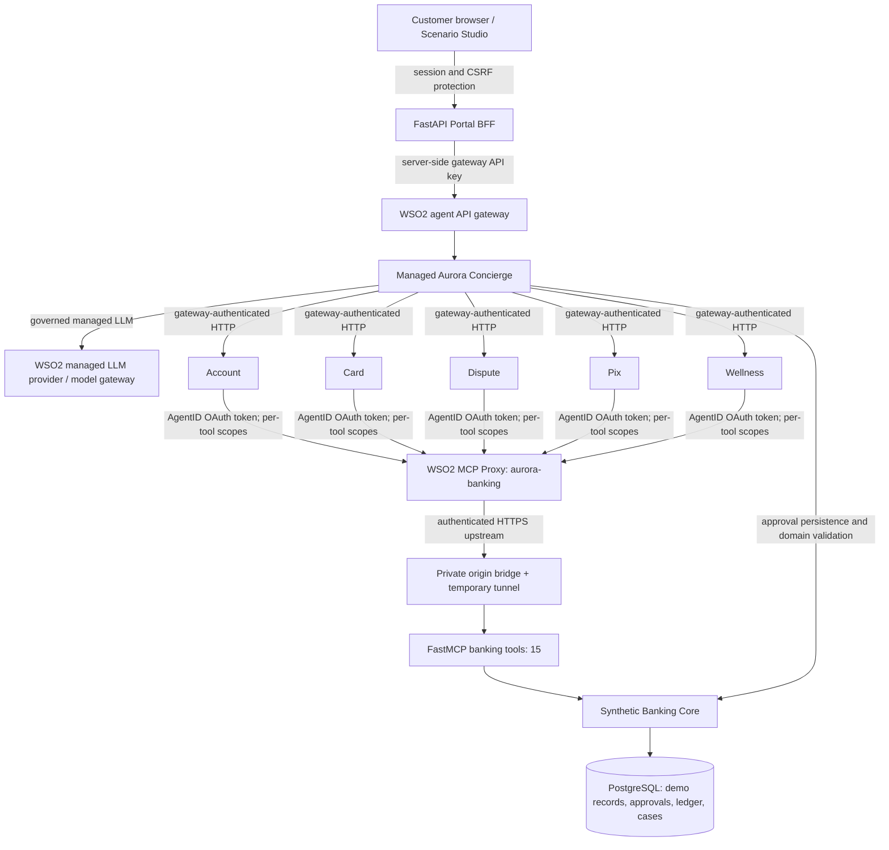

# Banco Aurora — Governed Multi-Agent Digital Banking Demo

> **One fictional customer, one Concierge, five specialist agents, and one governed banking-tool gateway.**
>
> **Scope:** This is a **synthetic, self-hosted WSO2 Agent Manager 1.0.0 demonstration**, not a real bank, payment-rail integration, production security blueprint or compliance certification. All customer records, payments, disputes and approvals are simulated. Never connect it to real financial systems or publicly expose the demo Portal, Core or upstream MCP server.

## Contents

1. [The experience and business value](#1-the-experience-and-business-value)
2. [Architecture and trust boundaries](#2-architecture-and-trust-boundaries)
3. [Agents, tools, policies and observability](#3-agents-tools-policies-and-observability)
4. [Reference data and expected outcomes](#4-reference-data-and-expected-outcomes)
5. [Prerequisites and credentials](#5-prerequisites-and-credentials)
6. [First installation on macOS + Colima](#6-first-installation-on-macos--colima)
7. [Starting, stopping and checking](#7-starting-stopping-and-checking)
8. [Live executive demo: S01–S08](#8-live-executive-demo-s01s08)
9. [Security acceptance and test commands](#9-security-acceptance-and-test-commands)
10. [Troubleshooting guide](#10-troubleshooting-guide)
11. [Secure image lifecycle and incident response](#11-secure-image-lifecycle-and-incident-response)
12. [Source control, builds and CI](#12-source-control-builds-and-ci)
13. [What is and is not demonstrated](#13-what-is-and-is-not-demonstrated)
14. [Project structure and operational reference](#14-project-structure-and-operational-reference)

## 1. The experience and business value

**Camila Rocha** is a fictional Brazilian banking customer. She notices a **R$ 1,280.00 charge at Orion Digital** that she does not recognize. She needs her card blocked, a dispute opened, a **R$ 1,250.00 Pix payment** made to an *already verified* condominium beneficiary, and an assessment of upcoming expenses.

Instead of navigating several isolated banking systems, Camila chats with **Aurora Concierge**. The Concierge plans the work, delegates to independently deployed specialists, requests explicit human authorization where needed, and composes a grounded response from banking records. **The model is not allowed to invent a card block, dispute result, Pix settlement, bank balance or policy approval**: the simulated Banking Core owns persisted state, validated commands and receipts.

The business message is **governed orchestration**, not autonomous unsupervised payments. Show the audience the difference between (a) planning, (b) preparing pending approvals, (c) deliberate human consent and (d) confirmed side effects. Distinguish a dispute **under review** from a refund; no immediate refund occurs.

## 2. Architecture and trust boundaries



**Execution boundaries:**

- **Browser → Portal:** The browser does not receive Agent Manager gateway keys, managed LLM credentials, MCP origin secrets or Core service keys. This is a demo login with signed server-side session controls, **not retail banking identity assurance**.
- **Portal → Concierge:** The BFF uses its own server-side gateway credentials. The Concierge is the only customer-facing agent; the five specialists are separate managed deployments.
- **Concierge → specialists:** Each specialist endpoint has an independently configured API gateway credential, separate from the application's internal call key. In-cluster routing must preserve the gateway's virtual-host routing.
- **Specialists → MCP:** AgentID obtains a scoped OAuth token for the registered MCP proxy. **Every exposed MCP tool needs its own scope**. Role assignments must match deployed AgentID identities. Concierge has no banking MCP role.
- **MCP proxy → Banking MCP upstream:** The gateway authorizes tool invocations, then forwards through an authenticated public-HTTPS bridge to the synthetic bank's internal MCP server. A Cloudflare Quick Tunnel is temporary and not guaranteed to remain connected. For scheduled demos, prefer stable managed ingress or a named tunnel.
- **Core and DB:** Domain validations, ownership checks, approval replay defenses, idempotent writes, persisted audit events and integer-cent balances are enforced independently of any LLM suggestion. PostgreSQL is a demo database, not a production ledger.

**Control-plane versus data-plane:** WSO2 Agent Manager creates/builds/deploys managed agents and stores configuration. API and MCP gateways handle runtime traffic. The local Colima/k3d cluster hosts the demo infrastructure; published managed builds are versioned from Git source. Do not conflate successful build/deployment with successful banking scenarios.

## 3. Agents, tools, policies and observability

| Managed agent | Purpose | Example authorized capability |
|---|---|---|
| `aurora-concierge` | Intent understanding, parallel delegation, response composition and approval coordination | Calls specialist agents; no direct banking MCP tool scope |
| `aurora-account` | Account balance, posted account activity and relevant financial context | `get_account_balance`, `list_account_transactions` |
| `aurora-card` | Card state and preparing/performing authorized card blocks | `get_card_status`, `request_card_block`, `execute_approved_card_block` |
| `aurora-dispute` | Relevant card transactions, disputed charge, human case workflow | `list_card_transactions`, `request_dispute`, `execute_approved_dispute` |
| `aurora-pix` | Verified beneficiary and guarded simulated Pix proposal/execution | `list_beneficiaries`, `request_pix`, `execute_approved_pix` |
| `aurora-wellness` | Known obligations, policy-grounded what-if planning | `get_upcoming_obligations`, account-read as authorized |

The **15 MCP tools** include account/card/dispute lookups, beneficiaries, upcoming obligations, human case reads/creation, and the request/execute pairs for card blocking, dispute and Pix. Source definitions in `mcp_server/` and registered proxy scope assignments are the authority; do not widen an agent's role for convenience.

**Knowledge and AI:** fictional policy content is retrieved from the versioned knowledge set for appropriate specialist responses; account balances and transaction evidence come from Core/MCP, not RAG. The managed LLM is configured through Agent Manager; secret-backed provider configuration must be verified in the actual deployed Pod. A local evaluation scorecard does **not** establish that WSO2 native monitors, guardrails or model-evaluation policies were enabled.

**Auditability:** inspect service logs, correlation identifiers, WSO2 Gateway/API observability and managed traces separately. If native OpenTelemetry/Jaeger integration is configured, show recorded spans from the actual run rather than claiming capabilities from static configuration. Before an executive demo, verify any monitors/evaluators/guardrails that you plan to describe.

## 4. Reference data and expected outcomes

| Metric | Initial synthetic state | After the approved story |
|---|---:|---:|
| Checking balance | **R$ 8,450.00** | **R$ 7,200.00** after exactly one simulated Pix |
| Orion Digital credit-card charge | R$ 1,280.00 posted | Still posted; disputed, **not refunded** |
| Card | Active | Blocked after explicit approval |
| Dispute | None | One case under review |
| Pix to verified condominium beneficiary | Not sent | One settled *simulated* payment: R$ 1,250.00 |
| Upcoming known obligations | R$ 2,100.00 | Same |
| Balance less known obligations | R$ 6,350.00 | R$ 5,100.00 |

These numbers apply to the **seeded baseline**. Acceptance scenarios reset or change the synthetic environment; do not present figures from a previously mutated instance as if it were a fresh baseline. Avoid floating-point financial arithmetic in any extensions to the Core; the domain implementation stores BRL cents as integers.

## 5. Prerequisites and credentials

**Verified operating target:** macOS, Colima, Docker CLI/Engine, k3d, `kubectl`, Python 3, Git, `cloudflared`, WSO2 Agent Manager **1.0.0** and its matching `amctl`. The local cluster convention in this demo is `k3d-amp-local` (validate the actual context before acting). WSO2 CLI access requires a real interactive login when not already authenticated. Managed model use needs a configured, working provider credential. Git-based managed builds need access to this repository's published branch and matching source revision.

```bash
command -v colima docker k3d kubectl amctl cloudflared python3 git
kubectl config current-context
amctl context show
colima list
k3d cluster list
```

**Secrets:** `agent-manager-support/secrets.env`, `agent-manager-support/support.env` (environment-specific settings), managed Secret references, any tunnel origin key and provider API keys are local/private. Configure `agent-manager-support/support.env` from `support.env.example` when needed; keep it `chmod 600`. Never paste values into tickets, Git commits, screenshots or terminal recordings. `*.example` files must contain placeholders only. The runtime-specific portal credentials, login code and operator code must not be embedded in browser JavaScript.

```bash
[ -f agent-manager-support/support.env ] || cp agent-manager-support/support.env.example agent-manager-support/support.env
chmod 600 agent-manager-support/support.env
```

Review settings before `up`, including Colima profile, target k3d context, support image name, organization/project and the managed LLM provider configuration. Avoid copying a credential from an old Pod into a manifest or Git file.

## 6. First installation on macOS + Colima

```bash
git clone https://github.com/joaokuntzwso2/demo-banking-agent.git
cd demo-banking-agent

# Configure local-only settings; never commit these values.
[ -f agent-manager-support/support.env ] || cp agent-manager-support/support.env.example agent-manager-support/support.env
chmod 600 agent-manager-support/support.env

# Read first; no Git publication enabled by default.
unset AURORA_AGENT_SOURCE_PUBLISH

# Start/reconcile local Agent Manager, support services, HTTPS MCP upstream,
# registered MCP proxy, six managed agents, Portal and acceptance checks.
./scripts/start-everything.sh up
```

**The sequence performed by `up`:** (1) provision or reuse the local Agent Manager + Kubernetes cluster; (2) prepare and reconcile PostgreSQL/Core/MCP support; (3) establish or check the authenticated public MCP HTTPS bridge and recover an expired Quick Tunnel; (4) verify MCP proxy, exactly 15 tools and least-privilege OAuth scopes; (5) create/reuse six separately built managed agents with genuine Secret-backed configuration; (6) verify five AgentID role assignments and Portal; (7) execute **stateful synthetic S01–S06** and a real allowed/denied AgentID tool test. No success is reported if a gate fails.

**First-run limitations:** This workflow depends on platform access, selected CLI API behavior, sufficient Docker/k3d resources, published Git source and valid LLM credentials; it cannot fabricate those. A newly built agent or a pending build is not automatically a failed build. If inventory API temporarily fails, inspect the exact build before resuming to avoid a duplicate. An expired Cloudflare Quick Tunnel must be republished and its proxy upstream updated; status based solely on a process ID is insufficient.

**Source changes:** Managed agents build from `deployment/agent-manager/apps/*` at a published Git revision. Editing `agents/*.py` locally is **not enough**: run the existing source synchronization workflow, review generated diffs and publish source deliberately before managed builds. The opt-in environment variable is `AURORA_AGENT_SOURCE_PUBLISH=1`; do not use it for ordinary runs or with unrelated staged changes.

## 7. Starting, stopping and checking

```bash
./scripts/start-everything.sh status       # read-only inventory
./scripts/start-everything.sh check        # live stateful scenario acceptance and AgentID proof
./scripts/start-everything.sh agents       # verify/reconcile managed agents on healthy support stack
./scripts/start-everything.sh up           # full stack start/reconcile (may deploy/build)

bash scripts/publish-mcp-secure-tunnel.sh status
bash scripts/publish-mcp-secure-tunnel.sh diagnose
python3 scripts/verify-aurora-tunnel-public.py
```

For Portal access, the local support scripts can expose the Portal on **`127.0.0.1:8300`**. An already-used port can block a fixed bind; the acceptance runner uses an automatically assigned loopback port forward. To expose Portal manually without displacing another service:

```bash
kubectl --context k3d-amp-local -n aurora-demo port-forward svc/aurora-portal 8300:8300 --address 127.0.0.1
# In a second terminal: open http://127.0.0.1:8300
```

**Check the Service name in your actual cluster** with `kubectl --context k3d-amp-local -n aurora-demo get svc` before using the manual example. Stop only the foreground `kubectl port-forward` with Ctrl-C when finished. To stop the Quick Tunnel without deleting bank data:

```bash
bash scripts/publish-mcp-secure-tunnel.sh stop
```

This disables remote MCP access and will make specialist calls fail until restarted. Do not use broad `docker compose down -v`, `colima delete` or `k3d cluster delete` as a cleanup shortcut; those can erase persisted demo data or unrelated local infrastructure.

## 8. Live executive demo: S01–S08

**Rehearsal:** run `./scripts/start-everything.sh check` against **synthetic demo data** before opening the stage; this check can create approvals, execute simulated writes and reset/advance scenario state. Recheck baseline if you perform manual steps afterward. Capture the Console and Portal windows in advance, and use English or Spanish consistently for the customer conversation.

Suggested 12–15-minute presentation:

1. **Opening (1 min):** Show the Portal and fictional customer Camila. Explain that the assistant is a team of six platform-hosted agents, not one model with unrestricted database access.
2. **S01 — Fraud (3 min):** “I don't recognize the R$1,280 Orion Digital charge. Block my card and open a dispute.” Show separate **pending `block_card` and `open_dispute` approvals** before confirming. Approve only the intended synthetic actions; show the card blocked and one dispute under review, without claiming an immediate refund or checking-account debit.
3. **S02 — Pix (2 min):** “Pay R$1,250 to my verified condominium beneficiary by Pix.” Highlight beneficiary verification and user authorization. Show **exactly one** simulated payment, a single ledger debit and checking balance **R$7,200**. Explain idempotent retry protection.
4. **S03 — Unverified recipient (1 min):** Request payment to an unverified recipient. Demonstrate refusal: no authorization to execute, no debit. If optional Risk Advisor is registered, label its extra context separately from the five managed specialists.
5. **S04 — What-if planning (1 min):** Ask whether upcoming obligations are affordable. Show R$2,100 in known commitments and **R$5,100** remaining after the approved Pix. No payment or approval should be produced by this hypothetical question.
6. **S05 — Human escalation (1–2 min):** Open a human support case; demonstrate operator ownership and status progression, not invented automation by the LLM.
7. **S06 — Privacy (1 min):** Try to elicit another customer's balance or bypass system rules. Show refusal and no cross-customer specialist disclosure.
8. **Native security (1–2 min):** Show WSO2 AgentID roles and tool-specific MCP scopes. Execute the positive/negative verifier: Account balance read succeeds, Account card read is denied by the **real MCP gateway, HTTP 403**. Explain why an application-only allowlist is insufficient.
9. **S07/S08 — Optional platform operator features:** In WSO2 Console, show real trace/evaluation evidence (S07), or version/release/promotion workflow (S08) **only if configured and actually verified**. These are not part of the S01–S06 customer acceptance test.

**Presenter guardrails:** Any error is a demo environment issue, not customer bank data. Do not switch to a heuristic fall-through after a governed-model failure. For approvals, never fabricate success or replay a write blindly after a network timeout; re-read Core state first.

## 9. Security acceptance and test commands

```bash
# Full live stateful acceptance; includes S01–S06 and the gateway denial test.
./scripts/start-everything.sh check

# Focused smoke calls (safe, read-only unless otherwise noted)
python3 scripts/diagnose-aurora-chat.py
python3 scripts/verify-aurora-tunnel-public.py
python3 scripts/verify-aurora-agentid-denial.py        # read-only inspection
python3 scripts/verify-aurora-agentid-denial.py --run  # live OAuth + two read-only MCP tool calls

# S01: can create pending SYNTHETIC approvals; does not authorize them.
python3 scripts/diagnose-aurora-s01.py

# Unit/regression tests (isolated code tests; NOT proof of deployed endpoints)
python3 -m unittest discover -s tests -p 'test_*.py'

# Release-policy audit, plus optional full Git-history scan with Gitleaks
python3 scripts/aurora-release-audit-v12.py
python3 scripts/aurora-release-audit-v12.py --history
```

**Acceptance:** HTTP 200 on Portal-to-Concierge, six scenario assertions pass, 15 registered MCP tools/scopes verified, AgentID Account's allowed `get_account_balance` call succeeds and forbidden `get_card_status` returns **gateway HTTP 403**, not an exception from a Python allowlist. An unset `AURORA_MCP_AUTHZ_VERIFY_CMD` must not make checks pass; the native verifier is the default on this release.

## 10. Troubleshooting guide

| Symptom | Next verified check | Typical cause / safe action |
|---|---|---|
| Portal login fails | Portal logs and environment template, `kubectl get svc/pods` | Auth/session config; don't print cookies or codes |
| `POST /api/chat` returns 503 | `python3 scripts/diagnose-aurora-chat.py` | Isolate BFF vs Concierge vs model |
| Managed LLM gateway works through port-forward but Concierge fails | `scripts/diagnose-aurora-llm-http.py --smoke` and in-pod `scripts/diagnose-aurora-llm-pod-http.py --smoke` | SDK constructor/header incompatibility, process-level config, payload; no raw credentials in output |
| Banking Core connection failure | `scripts/diagnose-aurora-core-egress.py` | Verify narrowly scoped Concierge-to-Core NetworkPolicy, not a blanket allow-all |
| Card/Dispute selected but no approvals | `python3 scripts/diagnose-aurora-s01.py`; Dispute logs | MCP initialization/upstream failure, role scopes, gateway auth; don't disable S01 assertion |
| MCP Gateway HTTP 503 | Tunnel status **and** `python3 scripts/verify-aurora-tunnel-public.py` | Quick Tunnel may have expired while `cloudflared` PID remains running |
| cloudflared `Unauthorized: Tunnel not found` | `publish-mcp-secure-tunnel.sh diagnose` | Rotate tunnel through controlled proxy update, **no proxy recreation** |
| Expired Quick Tunnel | See commands below | Keep original MCP proxy, roles, secrets; re-register only HTTPS upstream |
| Build `pending`/`running` for several minutes | `amctl agent build list <agent> --project banco-aurora --org default --json` | Platform-owned build can outlive CLI; do not submit duplicate |
| Build inventory CLI exits 1 | Query build by exact build name / Agent Manager Console | Transient API/read fault is not proof of build failure |
| OAuth scopes fail | `verify-aurora-agentid-denial.py --run` | Verify role mapping/token audience/resource and tool coverage; never bypass the 403 gate |
| Port 8300 in use | `lsof -nP -iTCP:8300 -sTCP:LISTEN` | Use separate port or runner's automatic loopback bind |
| Git source and published managed bundles differ | `scripts/sync-managed-agent-source.py` normal preflight | Regenerate/review, then explicitly publish the intended revision; don't deploy stale builds |

**Tunnel recovery — execute only after the public HTTPS check fails:**

```bash
bash scripts/publish-mcp-secure-tunnel.sh stop
AURORA_ALLOW_EPHEMERAL_PROXY_UPDATE=true bash scripts/publish-mcp-secure-tunnel.sh up
python3 scripts/verify-aurora-tunnel-public.py
python3 scripts/aurora-full-reconcile.py check-proxy
```

Expected: newly registered Quick Tunnel URL, public authenticated-bridge marker, exactly 15 MCP tools and matching scopes, S01 Card/Dispute approvals from their specialists. **Do not delete the MCP proxy or its scopes to fix an expired tunnel.**

**Redaction rule:** never paste raw env dumps, `kubectl get secret -o yaml`, bearer tokens, gateway API keys, OpenAI provider keys or unsanitized debug logs in an issue. Include error class, HTTP code, managed build name, agent role, status and sanitized trace/correlation identifier instead.

## 11. Secure image lifecycle and incident response

**Git exclusions and Docker exclusions are different.** A file ignored by Git can still be copied into a Docker image by `COPY . .` unless `.dockerignore` excludes it. This repository therefore maintains broad exclusion patterns for secrets, support runtime state, Kubernetes credentials, local credential material and tunnel artifacts. **Use the root Docker build context and inspect it**; other Dockerfiles may have different context roots.

**Before announcing a clean release:** (1) scan current Git and all reachable history for secrets; (2) verify `.dockerignore` excludes support secrets and runtime files; (3) rebuild the support image using the secured context; (4) redeploy affected Aurora workloads and verify Pods are running the new image digest; (5) remove only obsolete, unused Aurora support images. A Docker image tagged with the same string as its predecessor is not proof that a Pod has reloaded new bytes. Do not remove currently used images or purge all Docker images.

```bash
# Read-only image inventory, including project-specific tags and workload use.
python3 scripts/retire-aurora-local-images-v12.py

# BEFORE rebuilding, record old local image IDs (outside Git).
python3 scripts/retire-aurora-local-images-v12.py --record-baseline

# Check what the new image actually contains after rebuilding; do not print values.
# Replace IMAGE with the exact verified image reference from docker image ls.
docker run --rm --entrypoint sh IMAGE -c \
  'test ! -e /app/agent-manager-support/secrets.env && test ! -e /app/agent-manager-support/support.env'
```

**Rebuild/roll out safely first:** After the v12 source has passed local tests, is committed/pushed, and the generated six managed bundles have been deliberately synchronized, run `AURORA_REFRESH_BACKEND=1 ./scripts/start-everything.sh up`. Inspect the actual new Docker image ID and the managed support Pod container image IDs before considering an old image unused. Never run a cleanup step against a Pod still using an old image.

**Controlled retirement of one exact Aurora support tag:**

```bash
# A dry-run with the exact candidate image tag:
python3 scripts/retire-aurora-local-images-v12.py --image aurora-banking-support:amp-v4

# Only after Pods have moved to the verified clean digest and the tool confirms
# no container/Pod references it (see tool output):
python3 scripts/retire-aurora-local-images-v12.py \
  --image aurora-banking-support:amp-v4 --execute --confirm-retire
```

The utility refuses to delete tags referenced by existing Docker containers or current k3d Pods. To check a prior, now-dangling image **ID** after a rebuild, use the private baseline created above:

```bash
python3 scripts/retire-aurora-local-images-v12.py --baseline ~/Downloads/aurora-image-baseline-YYYYMMDDTHHMMSSZ.json
# Only if all safety checks show it is unused:
python3 scripts/retire-aurora-local-images-v12.py \
  --baseline ~/Downloads/aurora-image-baseline-YYYYMMDDTHHMMSSZ.json \
  --execute --confirm-retire
```

If a running Pod still references the same tag, the baseline retirement will **refuse** the action because containerd digests cannot be inferred reliably from a local Docker ID. Do not bypass that safeguard without verifying the Pod has a new, clean image digest. The utility does **not** delete registries, k3d/containerd cached image layers or unrelated Colima volumes. Check k3d nodes and registries explicitly before certifying all copies removed. If any real credential may have entered a former image or Git history, **rotate it first**, invalidate old credentials, and treat historical copies as exposed until investigated. A new `.dockerignore` cannot retroactively remove a secret from existing images or Git objects.

## 12. Source control, builds and CI

- **Canonical sources** live under `agents/`, `banking_common/`, `mock_core/`, `mcp_server/` and `demo_portal/`. Generated managed app bundles in `deployment/agent-manager/apps/` must match canonical source before a managed Git build.
- **Git hygiene:** Never commit `agent-manager-support/secrets.env`, runtime `support.env`, `.env.local` files, Quick Tunnel state, keys, tokens, build logs, Docker layers, private inventories or real endpoint credentials. `git diff --cached --check` and path checks are necessary but not sufficient; use secret scanning.
- **Dependencies:** Existing requirements can permit semver drift. Validate and commit an appropriate resolved, tested lock/constraints set as a separate, controlled change **before** claiming bit-for-bit reproducibility. The release audit warns on unpinned runtime dependency manifests rather than inventing package versions or breaking an already working build. CI performs regression and secret checks; Dependabot proposes future upgrades.
- **Image provenance:** Pin base images by digest only after choosing and validating the corresponding image on your target CPU architecture. Unknown digests should never be fabricated. Production hardening (non-root, restricted privileges, seccomp, read-only root filesystem) requires rebuilding and smoke-testing the actual support containers and their writable mounts; do not apply an untested `runAsNonRoot` to a root-dependent image.
- **Source verification:** `git rev-parse HEAD`, `git ls-remote origin refs/heads/main`, and `git diff --check`; explicit publish is required for managed-source changes. No automatic Git push is part of image cleanup or the release installer.

## 13. What is and is not demonstrated

**Demonstrated when live gates pass:** six separately deployed agents, LangGraph orchestration, a configured governed LLM, API-key protected inter-agent calls, persisted synthetic workflows, human approval controls, tool-level MCP scopes with a real 403 denial, scenario-specific refusals, Core-owned financial state and an authenticated MCP upstream.

**Not implied by those checks:** production bank authentication/FAPI compliance, real Pix network clearing or banking integrations, durable cross-region DR, external multi-tenant hardening, full software supply-chain certification, native WSO2 guardrails/traces/evaluation monitors, Agent Kinds/promotion/rollback, production-quality payment fraud screening, PCI controls or regulated operational assurance. If a feature exists as an example or manual Console instruction, show its *actual configured state* before naming it as delivered.

## 14. Project structure and operational reference

```text
agents/                         Canonical Concierge and specialist logic
banking_common/                 Shared domain, auth, telemetry and configuration
mock_core/                      Synthetic bank operations and persisted business state
mcp_server/                     Fifteen governed banking MCP tools
knowledge/                      Fictional policy content for grounded answers
demo_portal/                    Customer portal + FastAPI BFF
deployment/agent-manager/apps/   Six Git-built platform-hosted agent bundles
deployment/agent-manager/        Managed platform deployment templates
agent-manager-support/          Local k3d/Colima support services and MCP publisher
scripts/start-everything.sh     Main bootstrap / reconcile / acceptance entry point
scripts/aurora-full-reconcile.py  Strict configuration reconciliation
scripts/run-executive-scenarios.py  Stateful synthetic customer acceptance
tests/                           Unit/regression/security scenarios
.github/workflows/               Release CI and security checks
README.md                        Single authoritative setup and demo guide
```

**Primary public docs:** [WSO2 Agent Platform](https://wso2.com/agent-platform/docs/) · [MCP protocol](https://modelcontextprotocol.io/) · [Cloudflare Tunnel](https://developers.cloudflare.com/cloudflare-one/connections/connect-networks/).

**After changing canonical agent source:** `./scripts/start-everything.sh up` first enforces Git publication and generated-bundle consistency. First review and commit the v12 changes, push your branch, then perform the separately authorized managed-app source sync (`AURORA_AGENT_SOURCE_PUBLISH=1 python3 scripts/sync-managed-agent-source.py ensure`). The publisher will create/push its own narrowly scoped generated-source commit and refuses unrelated staged changes. Then run `unset AURORA_AGENT_SOURCE_PUBLISH; AURORA_REFRESH_BACKEND=1 ./scripts/start-everything.sh up` and require S01–S06 + the gateway 403 test to pass before your business presentation.

**Maintenance rule:** Update **this one README** when capabilities, commands, security boundaries or the presenter story change. Historical release/fix notes are intentionally removed from the top-level user documentation; code history and regression tests preserve implementation details.


### Service credentials: fail-closed defaults (v13)

For the Kubernetes Banking Core, upstream MCP and managed specialists, every
service-to-service authentication key must be configured using a private
Kubernetes Secret or the agent platform's secret-injection mechanism. Missing
keys or known public demo defaults are rejected even when `WSO2_MODE=false`.
The application never requires `WSO2_MODE=true` simply to protect Core secrets.

Legacy **isolated, localhost-only** Compose rehearsal may explicitly opt in by
setting `AURORA_ALLOW_PUBLIC_LOCAL_DEMO_KEYS=local-only`, with
`WSO2_MODE=false`. This opt-in is refused inside Kubernetes. Prefer unique
private development secrets even for local rehearsals. Never use the opt-in on
a publicly accessible service. Do not store real keys in Git or Docker images.

The canonical sources are `banking_common/security.py` and
`banking_common/config.py`. After code changes, regenerate the separately
committed `deployment/agent-manager/apps/` bundles using the guarded source
synchronizer, publish the reviewed Git commit, and then deploy/test the six
managed agents. Do not hand-edit generated bundles or delete an old image
before replacement workloads and the gateway-level 403 test are verified.


### v14 — self-healing MCP forwarding on the startup path

`./scripts/start-everything.sh up` now confirms a **real MCP `initialize`**
through the private Kubernetes Service forward at `127.0.0.1:18101` and starts
an owned background monitor. If the selected `aurora-mcp` pod is replaced and
its `kubectl port-forward` exits, the monitor reconnects the local-only
forward to the current Service backend. It does **not** rotate Cloudflare
URLs, create proxies, change MCP scopes, rotate credentials, reset data, or
rebuild agents. `up`, `agents` and `check` require the real Account AgentID
positive tool read and a **gateway HTTP 403** for forbidden tool access
*before* the stateful S01–S06 suite is allowed to run. A failed verification
fails closed and must never be counted as a passing demo.

Inspect the supervisor without printing secrets:

```bash
python3 scripts/aurora-mcp-forward-guard-v14.py status
```

`stop-monitor` stops only the owned supervisor, never the tunnel or database.
The existing `publish-mcp-secure-tunnel.sh stop` remains the supported tunnel
shutdown path. This monitor cannot heal a Cloudflare provider outage or a
misconfigured external WSO2 gateway; in either case the mandatory positive/403
proof blocks scenario execution and reports failure.

**Shared-data limitation:** The banking Portal and S01–S06 acceptance operate on
one synthetic customer in a shared Core database. The automatic gateway check
prevents MCP false readiness, but it **cannot prevent a presenter from placing
an additional Pix payment during the acceptance test**. Run `check` only when
no human is submitting UI mutations, or provide a separate test Core/database
and agent wiring. Do not suppress balance assertion failures or reset the
shared database unexpectedly to force a pass.


### v14.2 — MCP tunnel cleanup ownership handoff

The original tunnel publisher and the v14 forwarding monitor now coordinate
before **publisher-owned cleanup**. When a stale tunnel needs replacing,
`stop_all()` first asks the monitor to stop and waits for it to exit. It then
releases only a watchdog-tracked `18101` Kubernetes port-forward after checking
the exact process identity. The publisher continues its existing cleanup and
port-conflict checks. Unrelated listeners are never terminated, and a disputed
process identity fails closed. **This changes only the local tunnel lifecycle**;
it does not rotate keys, change AgentID scopes, rebuild agents or reset data.

After installing, run focused/full source tests, then `./scripts/start-everything.sh
up`. Confirm `python3 scripts/aurora-mcp-forward-guard-v14.py status` and the
real gateway proof. A future Kubernetes pod replacement should now be handled
by the watcher, while a deliberate tunnel replacement hands that watcher off
to the publisher first. The complete end-to-end behavior still requires live
acceptance on the intended Mac/cluster; simulated source tests are not proof
of a live recovery.
