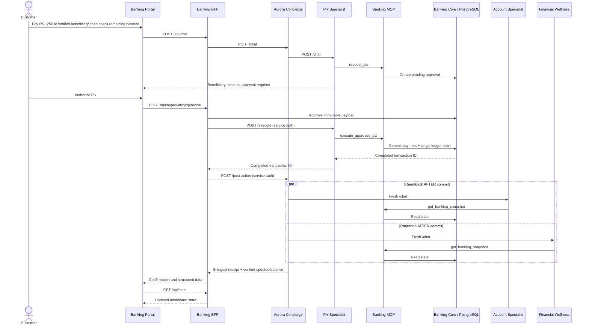

# Banco Aurora — conversational workflow correction

## Why this change is necessary

The first working Compose release showed a successful Pix execution as raw JSON
and displayed a pre-payment projection even when the customer had requested
"pay, **then** check my remaining balance". That was an incomplete workflow,
not a failure of the backend banking transaction.

The correct business sequence is:



The Concierge synthesizes an authoritative response only when the payment is
completed and a fresh account snapshot confirms the payment record. Financial
Wellness must agree with that balance and with the known obligations. If the
read-back fails, the receipt says the operation was completed but the balance
could not be verified; it does not invent a number. The browser never receives
the backend JSON as the primary conversational answer.

## Upgrade an existing local repository

From the directory containing `demo-banking-agent`:

```bash
unzip -o ~/Downloads/demo-banking-agent-conversation-fix.zip
cd demo-banking-agent

docker compose up -d --build --force-recreate
bash scripts/smoke-test.sh
open http://localhost:8300
```

This does not delete `.env` or the PostgreSQL volume. If you already completed
a Pix in the previous test, use **Reset demo** in the UI for a fresh scenario.
Do **not** use `docker compose down -v`.

## Demonstration acceptance scenarios

**English Pix scenario** (after Reset demo):

1. Ask `Will I have enough money after my upcoming expenses?`
   Expected balance R$8,450, obligations R$2,100, projection R$6,350.
2. Ask `Pay R$1,250 to my verified condominium Pix beneficiary, then check my remaining balance.`
   Expected pending Pix with a single authorization action; no claim of executed payment yet.
3. Authorize the Pix. Expected a conversational receipt with beneficiary,
   payment ID, balance R$7,200, obligations R$2,100, projection R$5,100.
4. Check Overview, Transactions and Payments; the bank state must match the receipt.

**Spanish:** Reset and switch the UI to **Español**. Ask:
`Paga R$1.250,00 por Pix a mi beneficiario verificado del condominio y revisa el saldo restante.`
The authorization and receipt must be Spanish, using R$1.250,00 notation.

**Multi-approval:** Reset, then ask:
`I don't recognize the R$1,280 Orion Digital charge. Block my card and open a dispute.`
Two independent actions should appear. Approving the card block does not
remove the dispute confirmation. The Cards and Disputes views should show the
committed state after each approval. A dispute is not a refund.

**Negative test:** Ask `Pay R$2,800 to my verified condominium Pix beneficiary.`
The specialist should reject the amount before creating an approval. Ask a Pix
question without a payment amount: it should not silently use R$1,250.

**Security note:** This local mode uses demonstration session tokens and a
shared internal key. It is **not** a fully governed on-premises Agent Manager
installation. On-premises deployment requires independently deployed agents,
registered/secured MCP Proxy, identity and authorization policies, secured
agent-to-agent calls, telemetry and e2e verification in the target environment.
